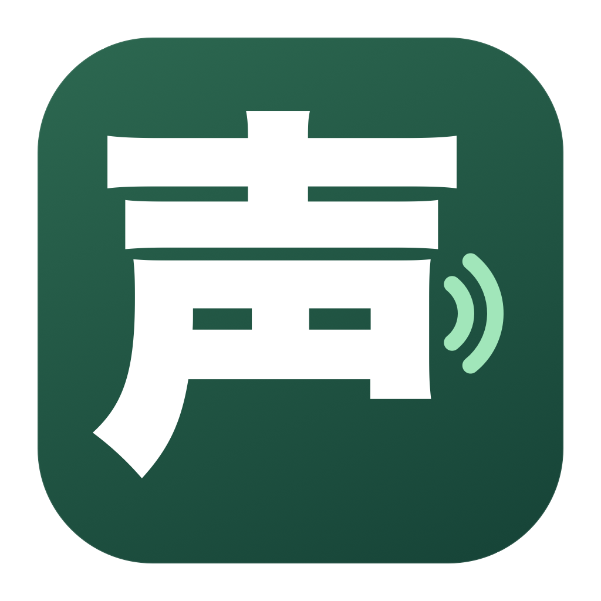

# こえのたね — Macの中で動く、無料の日本語音声入力



**Fn / 🌐 を押して話す。離すと、入力欄にことばが入る。**

こえのたね（声の種 / Voice Seed）は、日本語の音声を端末内で文字に変えるMacアプリです。利用料・APIキーは不要。Appleの音声認識を使うため、別のローカルLLMのインストールも必要ありません。

**公開準備版 0.4.0：現在はソースからビルドできます。一般向けの署名・公証済みダウンロード版は準備中です。** 自作版のアドホック署名と、一般向け配布版は異なります。

## 対応環境

| 項目 | 条件 |
| --- | --- |
| Mac | Appleシリコン（M1以降） |
| OS | macOS 26以降 |
| 認識言語 | 日本語 |
| 通信 | 初回のApple日本語モデル取得に必要。認識は端末内で実行 |
| 文章整形 | 任意。利用可能なApple Intelligenceが必要 |

Windows・Intel Mac向けのビルドは提供していません。Apple Intelligenceをオフにしても、文字起こし・辞書・ルールによるフィラー除去を使えます。

## できること

- Fn長押し録音、離して元の入力欄へ自動貼り付け
- 録音中から逐次認識して待ち時間を短縮
- 「えー」「えっと」などの明らかなフィラーを高速なルールで除去
- 任意のApple Intelligenceによる句読点・改行などの文章整形
- 専門用語・名前の認識ヒントと表記置換
- ATOK形式・Aqua Voice形式の辞書ファイル取り込み（追加前に確認）
- 録音ボタン、予備ショートカット、音声ファイルの文字起こし、編集・コピー

## インストールと初期設定

署名・公証済み版を公開したら、このリポジトリの[Releases](https://github.com/brandsmasaki-lang/voice-seed/releases)に掲載します。公開済みの版がない場合は、下記の開発手順でビルドしてください。

1. ダウンロード版はZIPを展開し、「こえのたね.app」をFinderの「アプリケーション」へコピーして開きます。
2. アプリの「設定」で「日本語モデルを準備」を押し、初回ダウンロードを待ちます。
3. 録音ボタンを押したときに、macOSのマイク利用を許可します。
4. Fn入力には「入力監視」と「アクセシビリティ」の許可も必要です。アプリの設定ボタンからmacOSの該当画面を開き、「こえのたね」をオンにしてください。
5. Macのキーボード設定で「🌐キーを押して実行する操作」を「何もしない」にします。同じキーを使う音声入力アプリは終了してください。
6. 設定に「① Fnキーの検知：準備完了」「② 自動貼り付け：許可済み」が表示されたら、入力先の欄をクリックし、Fnを押しながら話し、離します。

初めはTextEditなどの空のテスト文書で試してください。設定画面ではFnを押しても録音せず、検知状態だけを確認できます。許可が反映されない場合はアプリを終了し、開き直してください。

録音ボタンから開始した場合は、結果をアプリ内に表示します。録音は1回5分までです。自動貼り付けはクリップボードに結果を入れて⌘Vを送り、送信・実行キーは押しません。入力先が変わった場合や確認できない場合は、自動貼り付けを中止して画面に結果を残します。すべてのアプリ・入力欄での動作を保証するものではありません。

## フィラー除去と文章整形

| 設定 | 処理 | 初期状態 |
| --- | --- | --- |
| フィラー除去（ルール） | 明らかな「えー」「えっと」「あのー」などを端末内のルールで削除 | オン |
| 文章整形（Apple Intelligence） | 端末内LLMが句読点・改行・フィラーなどを文章全体から整える | オフ |

ルールでは「あの店」「ええ、賛成です」「えー！」、引用した言葉、明示登録した辞書語を残すようにしています。対象外のフィラーが残ることもあります。Apple Intelligenceの整形をオンにすると、その分の処理時間が加わります。どちらの方法でも意味が常に保持されるわけではないので、重要な文章は確認してください。

元の認識結果も画面で確認できます。「確定 ○秒」は録音終了から音声認識の確定までの時間で、文章整形や入力先への反映時間は含みません。

## 辞書を移す

「単語辞書 → 辞書を取り込む」から書き出し元を選び、利用者が用意したファイルを読み込みます。追加予定・重複・表記違い・形式外の内容を確認してから追加します。元アプリへのログイン、保存領域の自動探索、既存辞書の上書きは行いません。

| 書き出し元 | 対応形式 |
| --- | --- |
| ATOK | 読み・単語・品詞の一覧テキスト。先頭2列を使用。UTF-8 / UTF-16 / Shift JIS・CP932。バイナリの `.dic` は対象外 |
| Aqua Voice 単語辞書 | 1行1語のTXT、先頭列が単語のCSV・TSV、単語のJSON配列、dictionary/words配列を持つJSON |
| Aqua Voice 置換辞書 | from/toのCSV・TSV、タブ区切りTXT、from/toオブジェクトのJSON配列、replacements配列を持つJSON |

ATOKの辞書ユーティリティで「単語・用例の一覧出力」からテキストへ書き出します。Unicode出力を推奨します。製品によって名称が異なるため、[JustSystems公式手順](https://support.justsystems.com/faq/1032/app/servlet/qadoc?QID=056108)も確認してください。

Aqua Voiceは、利用者自身が[公式CLI](https://aquavoice.com/docs/cli#import-and-export)で書き出したファイルに対応します。

```sh
aqua dict export > dictionary.json
aqua replacements export > replacements.json
```

単語だけのリストは「認識ヒント」に登録し、置換には使いません。同じ読みに複数の表記がある場合も、特定の表記へ一律置換せず認識ヒントにします。1ファイル10MB・50,000件まで。品詞・学習頻度・変換エンジン・カスタム指示は移行しません。すべての製品版・書き出し形式を実機検証したものではありません。

## プライバシー

音声・認識結果・辞書を開発者やクラウドAIへ送信する機能はありません。マイク音声をファイルに保存せず、認識履歴も永続保存しません。設定・辞書はこのMacに保存します。コピー・貼り付け時の文字はシステムのクリップボードに残ります。[データの扱い](PRIVACY.md)をご確認ください。

## ソースからビルドする

AppleシリコンMac、macOS 26以降、macOS 26以降のSDKを含むXcodeまたはCommand Line Toolsが必要です。外部パッケージへの依存はありません。

```sh
bash scripts/test.sh
bash scripts/build.sh
open 'dist/こえのたね.app'
```

結果は `dist/こえのたね.app`。ローカル開発用のアドホック署名を付けます。再ビルドすると、入力監視・アクセシビリティの許可を再登録する必要がある場合があります。開発版の動作確認では `dist` の版を直接開いてください。`起動.command` は `/Applications` のインストール済み版を優先します。

```sh
'dist/こえのたね.app/Contents/MacOS/VoiceSeed' --diagnose
```

診断はバージョン・ビルド・モデルの状態をJSONで表示します。マイク録音や辞書の書き出しは行いません。指定した音声ファイルだけの検証用に `--transcribe-file` と `--benchmark-stream`、モデル準備に `--install-model`、指定文の整形に `--refine-text` もあります。音声検証コマンドは認識結果を標準出力へ表示するので、個人情報を含む出力を公開しないでください。

[開発への参加](CONTRIBUTING.md) / [リリース手順](docs/RELEASING.md) / [検証範囲](docs/VALIDATION.md) / [更新履歴](CHANGELOG.md)

## 開発元・サポート

- [株式会社ブランズバンクシステムズ](https://brands-bank.com/)
- [服部雅樹のX @masakihattori](https://x.com/masakihattori)
- [AI導入・開発相談LINE](https://line.me/R/ti/p/%40833ciyeu)
- [GitHub：ソースコードと不具合報告](https://github.com/brandsmasaki-lang/voice-seed)

LINEへの登録・相談は任意です。音声入力の利用にアカウント登録は必要ありません。不具合報告には実際の音声や個人辞書を添付せず、架空のデータで再現する手順を記載してください。[セキュリティ上の問題](SECURITY.md)は非公開の窓口をご利用ください。

コードとドキュメントは[MITライセンス](LICENSE)。第三者の商標・システムモデル・フォントの権利は各権利者に帰属します。[クレジット](THIRD_PARTY_NOTICES.md)も参照してください。

Voice Seed is a free, open-source Japanese dictation app for Apple Silicon Macs running macOS 26+. Hold Fn to speak, release to paste. Speech recognition and optional Apple Intelligence cleanup run on device. A signed and notarized binary is being prepared; source builds are currently available.
